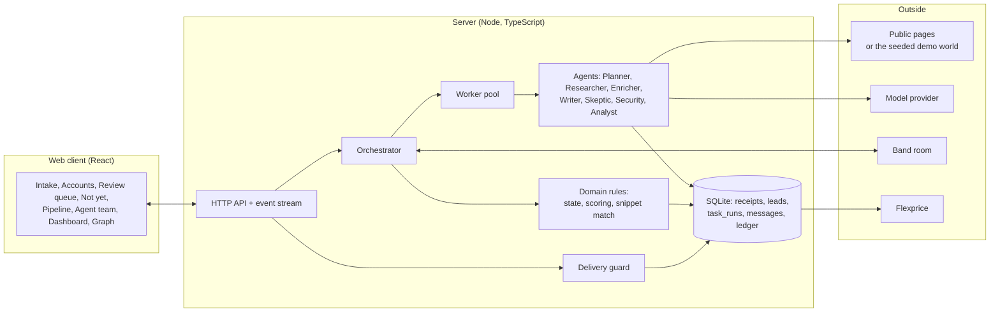
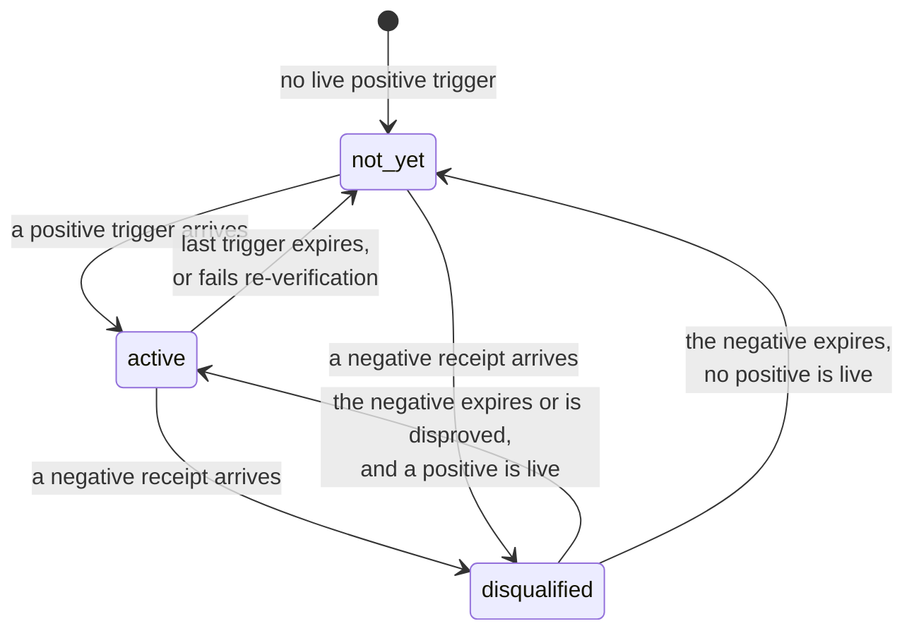

# Receipts: system design and architecture

Receipts is a GTM agent that only acts when it can prove why now. This document describes how it is built: the data model, the reasoning loops, the graph and its queries, the agent team, and the integrated services.

## 1. One primitive

Everything is built on one object. A **receipt** is a claim with a source, a sign and an expiry date.

| Field | Meaning |
| --- | --- |
| `claim` | One sentence stating the fact, naming the company |
| `source_url`, `snippet` | The public page, and the exact words on it that support the claim |
| `signal_type`, `sign` | What kind of fact it is, and whether it is a reason to contact or a reason not to |
| `event_at`, `seen_at`, `expires_at` | When it happened, when it was found, when it stops counting |
| `status`, `confidence` | Unverified, verified or failed; and the extraction confidence |

A receipt is written only if its snippet really appears on the cited page. Records are never typed in: every company field, contact and signal is a receipt.

## 2. Components



- **Domain rules** ([server/domain](../server/domain)) are pure functions: lead state, scoring, and snippet matching. They have no I/O and are unit tested.
- **Agents** ([server/agents](../server/agents)) do scoped work and return an outcome.
- **The orchestrator** plans and reconciles. **The worker pool** runs tasks in parallel under leases.
- **The delivery guard** is the only code that can mark a message sent.
- **One SQLite file** is the only store. The graph is a projection of it.

## 3. Data model

| Table | Holds |
| --- | --- |
| `receipts` | Every claim, with its source, sign, expiry and verification status |
| `verifications` | Append-only verdicts from the Skeptic; a receipt's status is the latest one |
| `companies`, `persons` | Accounts, competitors and contacts. Each field traces to a receipt |
| `leads` | One per account: state, stage, fit, intent, score, tier, dormant reason |
| `stage_transitions` | Every stage move, with actor type (agent or rep), actor, note and time |
| `icp_versions` | Each ICP with its fields, confidences, signal weights, expansions and rationale |
| `messages` | Drafts as lists of sentences, each a claim with receipt ids or a connective |
| `message_versions` | Append-only history of every draft: Writer's version, Skeptic's verdict, human edits |
| `runs`, `task_runs` | Pipeline runs and the durable tasks they fan out into |
| `activity` | The event stream: every handoff and block, linked to its task |
| `ledger` | Credit grants and metered charges |
| `llm_usage` | Tokens and cost of every model call, by agent and task |

## 4. Reasoning loops

### 4.1 Intake to ICP (Planner)

The Planner turns a product description, existing customers and pricing into industries, headcount bands, regions, personas and trigger events. Each value carries a confidence from 0 to 1. It proposes two adjacent segments with reasoning, which the user accepts or dismisses; an accepted segment widens the fit score.

With model credentials the Planner is a structured model call. Without them a keyword planner produces the same shape. Industry labels are a closed set so ICP fields and company records join exactly.

### 4.2 Discovery (Researcher)

One search task runs the search plan and decides which accounts are worth reading. It recognises competitors (same category, public price) and records them, because readers need their names. Then one read task per account runs in parallel: it reads that company's pages and writes receipts for firmographics and for positive and negative signals.

Extraction is rule-based on the seeded world and model-based on the live web. Both follow one contract: every fact carries the exact words that support it, and the caller rejects any fact whose words are not on the page.

### 4.3 State: restraint as a state machine

A lead has two independent properties. **State** is derived from live receipts; **stage** is the sales position.



Rules, checked on every change and on every clock tick ([state.ts](../server/domain/state.ts)):

1. Any live negative receipt: disqualified, and the reason is the claim.
2. Otherwise at least one live positive trigger: active.
3. Otherwise not yet: no trigger found, last trigger expired N days ago, or the only trigger failed re-verification.

Each signal type has a window (job posting 60 days, exec hire and pricing change 90, funding 120, hiring freeze 120, layoffs 180, signed with a competitor 365). A receipt outside its window stops counting, so a lead returns to "not yet" on its own.

### 4.4 Scoring

Score is 0 to 100: half fit, half intent, with every input kept ([scoring.ts](../server/domain/scoring.ts)).

- **Fit:** industry match 45, headcount band 35, region 20.
- **Intent:** for each live positive trigger, the signal type's weight times its freshness. Freshness falls linearly from 1 to 0.15 across the signal's window.
- **Tiers:** A at 65 and above, B at 45 to 64, C below.

The point values, windows and learning step are starting defaults to tune, not measured numbers.

### 4.5 Outreach (Writer, Skeptic, Security, Human)

An email is a list of sentences. Each is a **claim**, which must list the receipts it rests on, or a **connective**, which may not state a fact.

1. **Writer.** A model drafts under that format; a format check rejects an uncited claim, an unknown receipt id, or a figure that is not in the cited source. One retry, then a template writer in which every factual sentence is generated from a receipt.
2. **Skeptic.** Re-fetches every cited source and looks for the snippet. Gone, unreachable or changed all count as failed. A failed claim is struck and stays visible. A draft with no surviving claim is blocked.
3. **Security.** Scans what would actually be sent for unverified, shortened or internal links, credentials, internal record ids, other prospects' names, third-party email addresses, and a recipient outside the target company.
4. **Human.** Approves, edits or rejects. An edit is a new version and goes back through the Skeptic.

### 4.6 Learning (Analyst)

When a lead replies, the signal types cited in the email that earned the reply gain 25% weight. The change is saved as a new ICP version with its rationale, and every lead is rescored. Each version can be diffed against its parent and reactivated.

## 5. The knowledge graph

The graph is a projection of the receipts, not a second database. It is rebuilt from the store on demand, so it can never disagree with the records.

**Ontology**

| Nodes | Edges |
| --- | --- |
| Company, Person, Product, Competitor, Signal, Customer | `works_at`, `previously_employed_at`, `has_signal`, `matched_to`, `competes_with`, `contacted_via`, `replied_to`, `customer_of` |

Every edge that states a fact carries the id of the receipt behind it.

**Query logic.** Four named multi-hop questions ([snapshot.ts](../server/services/snapshot.ts), `GET /api/graph/query/:name`):

| Question | Traversal |
| --- | --- |
| Who can we reach through a company that already buys from us? | `(Person)-[previously_employed_at]->(Customer)-[customer_of]->(Product)` |
| Which open roles point at a buyer we can already name? | `(Signal: job posting)-[has_signal]->(Company)<-[works_at]-(Person)-[matched_to]->(Product)` |
| Which accounts are locked in with a competitor, and when does that stop counting? | `(Company)-[has_signal: signed]->(Competitor)-[competes_with]->(Product)` |
| Which untouched accounts show the same signal that earned a reply? | `(Company)-[replied_to]->(Product)`, then `(Company)-[has_signal]->(Signal type)<-[has_signal]-(Other company)` |

The per-lead path "why this person, why now, why us" is the walk Signal, Company, Person, Product, plus the warm-intro edge when one exists.

**Continuous ingestion.** A signal refresh re-reads every known account and re-checks every negative receipt. New receipts change edges; expiry removes them. Every graph query is counted as a metered event.

**Why not a graph database.** The spec suggests Neo4j or Kùzu. With tens to low thousands of accounts, the traversals above are short joins over one store, and deriving the graph removes the whole class of bugs where two databases disagree. The ontology and queries are written so that moving them to a native graph store is a mechanical change if the data outgrows this.

## 6. The agent team

One orchestrator plans, assigns and reconciles. Eight roles do scoped work and return an outcome. Only the orchestrator creates tasks.

```
Planner      one ICP run
Researcher   one search task, then one read task per account, in parallel
Enricher     one task per active lead, in parallel
Writer       one task per enriched lead, in parallel
Skeptic      one task per draft, in parallel
Security     one scan per verified draft
Human gate   one review task per cleared draft
Analyst      one task per outcome
```

Every unit of work is a durable **task run** ([tasks.ts](../server/services/tasks.ts)) with `run_id`, `lead_id`, `agent`, `status`, `depends_on`, `attempt`, `lease_expires_at`, and the receipt and message ids it was given and produced. Status is one of `queued`, `running`, `blocked`, `review`, `done`, `failed`.

- **Leased, not owned.** A worker holds a task for a short lease and renews it with a heartbeat. An expired lease is taken back and the task retried. A restart resumes the pipeline.
- **Settled once.** Only the worker holding the current lease can settle a task; a stale worker's late result is dropped.
- **Idempotent.** Every task has a key. Planning twice returns the same task, and a retried task does not pay twice.
- **Credits held per task** in priority order, so parallel work cannot overspend and a lead that is started can be finished.
- **Append-only.** Agents add receipts, verdicts and draft versions. The orchestrator derives lead state.

## 7. The human gate and delivery

[delivery.ts](../server/services/delivery.ts) is the only code that can mark a message sent. It requires an open human review task for that exact draft, refuses to run from inside any agent task, re-checks that every cited receipt is still live, and repeats the security scan. A test scans the source to confirm no other module can write the sent status.

Delivery itself is simulated: the send is recorded, charged and attributed, and nothing leaves the machine.

## 8. Integrated services

| Service | Role | State |
| --- | --- | --- |
| **Band** | The room where agents hand off by mention and a person approves. See [BAND.md](BAND.md) | Built to Band's documented Agent API and tested against a stand-in. Not yet run in a real room |
| **Flexprice** | Meters every billable operation as an event (lead enriched, draft generated, outreach sent, graph query evaluated) and holds the credit wallet. With `FLEXPRICE_WALLET=source` the wallet's real-time balance is the credit balance and the local ledger is a cache of it, so a top-up in Flexprice reopens the gate | Built to the published API reference and tested against a stand-in, including outages. Not yet run against a real account |
| **Credit gate** | Enrichment and drafting hold credits before they start; a task that cannot be afforded is blocked with the reason | Built and tested |
| **Snyk** | Dependency scan in CI | Workflow present; runs when `SNYK_TOKEN` is set |
| **Model provider** | Planner, Writer and live-web extraction | Run end to end with a real key. Every call has a deterministic fallback |
| **Moss** | Semantic search over receipts | Optional; rejoined to local records before leaving the API |

## 9. What the spec names, and what is used

| Spec suggests | Receipts uses | Why |
| --- | --- | --- |
| Neo4j or Kùzu | A graph derived from SQLite | See section 5 |
| Tavily, Serper, Playwright | The model provider's web search, plus direct page fetches; a seeded world by default | The Skeptic needs pages it can really re-fetch, including ones that change |
| Apollo, Hunter, Clearbit | Contacts read from the company's own public pages, plus a DNS mail-server check on the address | A contact has to come with a receipt. The check blocks mail to a domain that takes none; it does not claim the mailbox exists. A vendor adapter would slot in at the Enricher |
| SendGrid, Gmail, LinkedIn APIs | A logged send, and a provider-neutral inbound reply endpoint | Sending real email from a demo is a risk, not a feature |
| Next.js, Tailwind, Radix | React with Vite and hand-written CSS | One process, one port, no build service |

## 10. Testing

`npm test` runs:

- **Rule tests:** state, scoring, snippet matching, extraction, the sentence format, the security scan, cost calculation.
- **Scheduler tests:** dependencies, parallelism under a limit, retries, stale leases, idempotency, credit holds, and that workers cannot create tasks.
- **Send-gate tests:** delivery is refused without a human review task, from inside any agent task, and by an ordinary update.
- **Band room tests:** mention handoffs, the blocking review, a person approving and rejecting in the room, and an agent's forged approval being ignored.
- **Flexprice tests:** the customer and wallet are found or created once, usage is metered as events, the wallet balance becomes the credit balance in both directions, nothing is corrected mid-run, top-ups are idempotent, and an outage leaves the ledger untouched.
- **Mail server check:** a domain with mail servers, a null MX, no record, and a lookup that fails or times out.
- **One end-to-end run** of the pipeline over the HTTP API on the seeded world.
