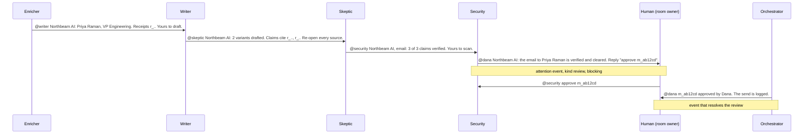

# Receipts in a Band room

Receipts runs its agent team in a Band room. The room is where one agent hands work to the next, and where a named person makes the call that releases a send.

This page covers the crew, who talks to whom, one flow end to end, what breaks without the room, and how to set it up.

## The crew

| Agent | What it does | Hands off to |
| --- | --- | --- |
| Planner | Turns the product description into an ICP and a search plan | Researcher |
| Researcher | Finds accounts and signals; writes a receipt for every fact | Enricher |
| Enricher | Resolves the contact; marks a guessed email as a guess | Writer |
| Writer | Drafts outreach in which every factual sentence cites receipts | Skeptic |
| Skeptic | Re-opens every cited source and strikes what it cannot confirm | Security |
| Security | Scans the verified draft for unverified links, leaked internal data and a wrong recipient | Human |
| Human | Approves or rejects, in the room | Analyst |
| Analyst | Reweights signal types from the reply and saves the next ICP version | Planner |

Each role can be its own Band remote agent with its own API key, so it speaks and is mentioned as itself. A role without a key speaks through the orchestrator's agent and says so (`[planner] ...`).

The Skeptic and the Security agent are critics: no draft reaches a person without passing both, and either can block it.

## Who talks to whom

Band routes a message only to the participants it mentions, so every handoff is a message that mentions the next agent.



What goes into the room:

- **Mention messages** for handoffs, one per lead per step. Each carries the receipt ids the next agent needs.
- **An attention event** (`kind: review`, `blocking: true`) for every draft that is waiting for a person, resolved by a later event when the decision is made.
- **Execution events** (`thought`, `error`) mirroring every handoff and block from the activity stream, so the people in the room can follow the work.

## One flow, end to end

1. The Researcher reports which leads have a live reason to contact and mentions the Enricher.
2. The Enricher resolves a contact for one lead and mentions the Writer with the contact's receipts.
3. The Writer drafts and mentions the Skeptic with the receipt ids its claims rest on.
4. The Skeptic re-fetches each source. One job posting has been taken down, so it strikes that sentence and mentions Security with the result.
5. Security finds no outbound links, no internal data and a recipient at the target company. It mentions the room owner and raises a blocking review.
6. The owner replies `approve m_ab12cd` in the room.
7. Receipts checks that the reply came from a person, runs the same approval as its own review queue, logs the send, resolves the review and confirms in the room.

If the Skeptic leaves no claim standing, it tells the human directly and no review is raised. If the owner replies `reject m_ab12cd too generic`, the draft is rejected with that reason and nothing is sent.

A person can also instruct an agent: `@writer keep every email under sixty words`. The instruction is stored as a note on that agent's standing task and applied on its next run.

## What breaks without the room

- **The decision has no place to happen in the open.** In the room, the request, the evidence it rests on, the person's answer and the outcome sit in one thread that everyone can see.
- **Handoffs become invisible.** Without the mention messages, one agent's finding (a struck claim, a guessed email) reaches the next only inside Receipts.
- **Nobody outside the app can steer.** Instructions to an agent from the room are how a teammate who is not in Receipts changes what the Writer does next.

The pipeline itself does not stop. Band is best-effort: if the room is unreachable, tasks still run and decisions are taken in the Receipts review queue. That is deliberate, because a send gate must not depend on a third party being up.

## Safety

- **Only a person can approve.** A reply is acted on only when Band reports `sender_type: "User"`. A message from any agent, including our own, is consumed and ignored.
- **The room has no shortcut to delivery.** A reply runs the same `approve` as the review queue, which needs an open human review task for that exact draft. The delivery service repeats the evidence check and the security scan before it logs a send.
- **Instructions are bounded.** A note from the room is capped in length and passed to the model as operator intent, to be followed only within the evidence rules.

## Setup

1. In Band, create a remote agent named `Receipts Orchestrator` and copy its API key.
2. Optionally create one remote agent per role (Planner, Researcher, Enricher, Writer, Skeptic, Security, Analyst) under the same owner and copy each key. Two or three are enough to show real handoffs; Writer, Skeptic and Security make the best demo.
3. Create a room, add yourself and the orchestrator, and copy the room id.
4. Put the values in `.env`:

   ```
   BAND_API_KEY=<orchestrator key>
   BAND_CHAT_ID=<room id>
   BAND_KEY_WRITER=<writer key>
   BAND_KEY_SKEPTIC=<skeptic key>
   BAND_KEY_SECURITY=<security key>
   ```

5. Start Receipts. On start it validates each key, adds the role agents to the room and logs who decisions go to. `GET /api/band/status` and the Agent team screen show the connection.

Other settings: `BAND_HUMAN_HANDLE` picks the person who decides when it should not be the room owner, `BAND_API_BASE_URL` overrides the host, and `BAND_POLL_MS` sets how often replies are checked (default 4000).

## What has and has not been tested

- **Tested:** the whole flow above, against a stand-in for Band's Agent API written from [docs.band.ai](https://docs.band.ai/api/agent-api). The stand-in enforces Band's documented rules: a mention is required, the mentioned participant must be in the room, and an agent cannot mention itself. See [test/band.test.ts](../test/band.test.ts).
- **Not tested:** a real Band room. No Band account was available while this was written, so the first run with real keys is the real test. Things most likely to need adjusting are the API host (the docs name both `app.band.ai` and `api.band.ai`; both are tried) and the shape of a participant's handle.
- **Polling, not WebSocket.** Replies are read with Band's `messages/next` endpoint on a timer. Band recommends its WebSocket for production; polling keeps the integration to plain HTTP.
- **One process.** The agents are separate identities in the room, but they run in one Receipts process. The handoffs that route work inside Receipts are its own task runs; the room carries the same handoffs in the open and carries the human decision for real.
